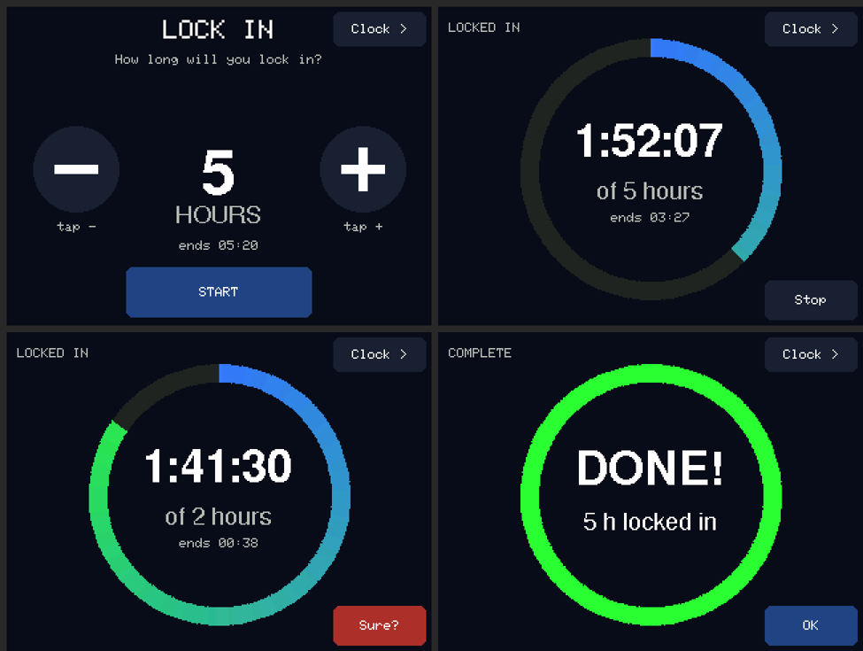
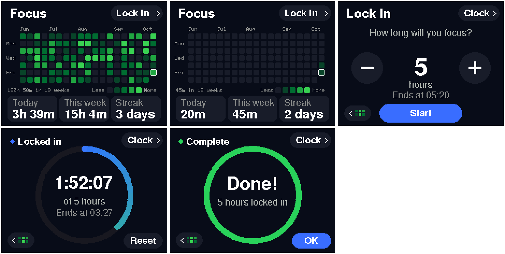
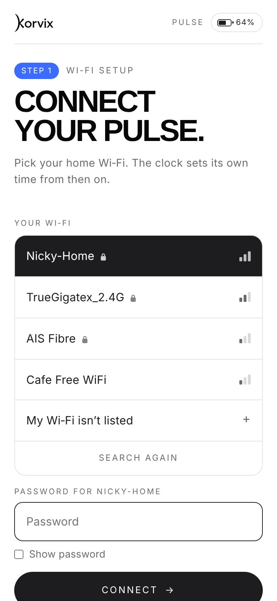
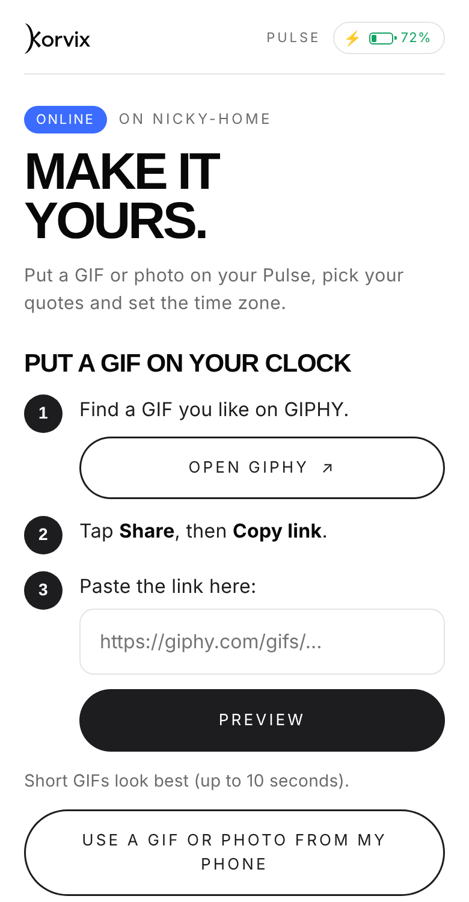

# Korvix Pulse: The Magic Clock

Firmware for **Pulse**, an animated desk clock by [Korvix](https://korvixtech.store), running on the
ESP32-2432S028 "Cheap Yellow Display" (2.8" 320 x 240 touch screen).

  

## Features

- **Day, sunset and night scenes** that follow the local time.
- **Your own GIFs and photos**, sent from your phone (GIPHY links work), framed in a live preview.
- **Quote of the hour**, editable from your phone.
- **Lock In** focus timer with a GitHub-style **focus calendar** and **streak**.
- **Phone setup by QR code**: no app; the phone gives the clock its Wi-Fi, time zone and time.
- **Battery version**: battery level, charging indicator and one-tap calibration (IP5306 power board).

 

 

## Build and upload

1. **Arduino IDE** with the board package **esp32 by Espressif Systems 3.3.11**.
2. Libraries: **Adafruit GFX Library**, **Adafruit ST7735 and ST7789 Library** (with Adafruit BusIO),
   **TJpg_Decoder** by Bodmer.
3. Open `DigitalClock/DigitalClock.ino`. Keep all its files together (including the large `EmbeddedAnimations.cpp`).
4. Board **ESP32 Dev Module**, Flash 4MB, CPU 240MHz, PSRAM disabled,
   **Partition Scheme: Huge APP (3MB No OTA/1MB SPIFFS)**.
5. Upload. On first start, tap the calibration crosses, then scan the QR code with your phone.

## Versions

All versions are the same sketch; pick one in `DigitalClock/Config.h`:

| Version | Setting |
| --- | --- |
| Standard | defaults |
| Battery | `BATTERY_INDICATOR = true` (wiring: [docs/BATTERY.md](docs/BATTERY.md)) |
| Demo / advert | `DEMO_FOCUS_HISTORY = true` (fills the focus calendar with sample data, never saved) |

The ILI9341 screen revision: set `CLOCK_USE_ST7789` to `0`.

## Repository

| Folder | What |
| --- | --- |
| `DigitalClock/` | The Arduino sketch |
| `web/page.html` | The phone page the clock serves. Edit it, then run `python tools/make_web_page.py` |
| `tools/` | Background video converter, time-zone generator, tests |
| `docs/` | [Seller guide](docs/SELLER-GUIDE.md), [battery wiring](docs/BATTERY.md), [validation notes](docs/VALIDATION.md) |

## Licence

Code, web page and the built-in background animations: © 2026 Korvix,
[CC BY-NC 4.0](LICENSE). Free to use and change for **non-commercial** purposes with credit;
selling it or products built with it needs permission from Korvix.
Third-party parts keep their own licences: see [THIRD_PARTY_NOTICES.md](THIRD_PARTY_NOTICES.md).

Buy a ready-made Pulse at **[korvixtech.store](https://korvixtech.store)**.
